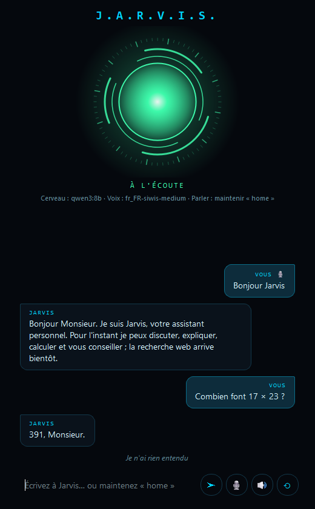

# Jarvis

Assistant personnel vocal de bureau, 100 % local par défaut : on lui parle, il répond à voix haute
et affiche le chat, des images et des résultats dans des pop-ups.

<p align="center"></p>

- **Cerveau** : Ollama (`qwen3:8b`), avec délégation à Claude Code pour le code
- **Voix** : faster-whisper (écoute) + Piper (parole)
- **Interface** : PySide6
- **Outils** : recherche web, lecture de pages et images (DuckDuckGo, sans clé API), affichés en pop-ups

Voir [ROADMAP.md](ROADMAP.md) pour les fonctionnalités et l'avancement, et
[docs/ARCHITECTURE.md](docs/ARCHITECTURE.md) pour l'organisation du code.

## Installation

Prérequis : [uv](https://docs.astral.sh/uv/) et [Ollama](https://ollama.com) avec le modèle `qwen3:8b`.

```
ollama pull qwen3:8b
uv sync
copy .env.example .env
```

## Utilisation

```
uv run jarvis          # application de bureau
uv run jarvis --cli    # version terminal
```

- **Parler** : maintenir la touche `Début` (réglable via `PTT_KEY`), parler, relâcher. Appuyer pendant que Jarvis parle lui coupe la parole.
- **Écrire** : taper son message puis Entrée.

Dans la fenêtre, les boutons de la barre du bas permettent d'envoyer, de parler (maintenir 🎙), de couper la voix et de démarrer une nouvelle conversation. En mode terminal : `/voix` (activer/couper la voix), `/reset` (nouvelle conversation), `/quit` (quitter).

Choisir le micro : `uv run python -m sounddevice` liste les périphériques, puis régler `MIC_DEVICE` (numéro ou morceau du nom).

Pour comparer les voix disponibles : `uv run python -m jarvis.voice.audition`, puis régler `TTS_VOICE` dans `.env`.

## Développement

Une branche par brique, une PR vers `main`, merge quand la CI est verte.

```
uv run pytest          # tests
uv run ruff check .    # lint
uv run ruff format .   # mise en forme
```
